# Reformulação visual da Academia Velarian

Branch: `design/academia-calculadoras-admin`. Revisão destinada ao PR #16, sem merge e sem publicação no Cloudflare Workers.

## Resultado

### Academia e Minha Academia

- Identidade preta e dourada com superfícies neutras, tipografia consistente, hierarquia editorial e menos elementos ornamentais repetidos.
- Início mais compacto, dois caminhos principais claros e tópicos em cartões com apresentação uniforme.
- Aulas em uma janela com título acessível, controles consistentes e leitura adaptada ao celular.
- Mantidas as quatro áreas do aluno: **Estudar, Certificado, Comunidade e Minha conta**. As abas agora têm semântica acessível e navegação pelas setas, Home e End.
- Progresso com valores acessíveis, aulas concluídas destacadas e persistência validada. A solicitação de certificado tem uma única ação visível; os mesmos endpoints, bloqueios e requisitos continuam ativos.
- Menu público com fechamento por Escape, suporte aos links adicionados dinamicamente e atalhos para pular ao conteúdo.

### Calculadoras

- Seleção lateral no desktop e seletor compacto expansível no celular. Busca sem distinção de acentos e categorias preservadas.
- Parâmetros separados dos resultados; valores principais destacados e textos explicativos mantidos em áreas expansíveis.
- Campos, erros, estados vazios e botões padronizados. Resultados anunciados por região de status acessível.
- As oito ferramentas continuam disponíveis, inclusive seus campos condicionais, atalhos de tempo e limpeza. **O motor `public/calculator-engine.js` não foi modificado.**

### Administração

- A rota `/admin` continua servindo **`public/admin-panel.asset`**, que recebeu a reformulação. `public/admin.html` foi sincronizado com esse documento para evitar divergência visual.
- Navegação agrupada em Principal, Ensino e alunos, Comunidade, Conteúdo do site e Gestão. Guias e Trade, já implementados, passam a ter entradas diretas.
- Área de trabalho mais compacta, indicadores organizados, relatórios legíveis e padrão comum para formulários, listas, imagens e janelas.
- Menu móvel com fundo de bloqueio, botão de fechar, contenção do foco e retorno ao botão de abertura ao fechar por Escape ou selecionar uma ferramenta.
- Mantida a remoção da opção **Modelo de certificado** do menu. A gestão de certificados permanece em Alunos; a emissão, os arquivos e as APIs existentes não foram removidos.
- Nenhuma atribuição de permissão foi alterada. As permissões e as proteções P1 continuam verificadas no servidor.

## Consolidação técnica

`styles.css` foi reescrito como um conjunto único de tokens, controles compartilhados, componentes e regras responsivas. Foram eliminadas as camadas históricas de sobrescritas; o arquivo passou de **95.528 para 54.370 bytes**, redução de aproximadamente **43%**, mesmo com formatação legível. As calculadoras possuem sua composição própria no arquivo existente `ferramentas.css`; patrocínios reutilizam os mesmos tokens em `sponsors.css`, sem estilos inline duplicados nos cartões.

Os principais caminhos foram verificados em **1440, 768, 390 e 320 px**. Nenhum transbordamento horizontal foi encontrado nos estados testados. Os endereços dos estilos e scripts alterados receberam novas versões de cache.

Não houve alteração em `worker.js`, `schema.sql`, `wrangler.jsonc` ou nas fórmulas. As contas e os indicadores das capturas são fictícios, criados exclusivamente em SQLite em memória. Não houve acesso a dados de produção.

## Testes locais

| Verificação | Resultado |
| --- | --- |
| `tests/design-browser.mjs` em Chromium com axe-core 4.11.0 | 5 grupos aprovados; **86 estados responsivos/acessíveis**; nenhuma violação automática WCAG A/AA nos estados testados; nenhum erro JavaScript não tratado |
| `tests/p1-regressions.mjs` | **14/14** |
| `tests/p1-browser.mjs` | **8/8** |
| `tests/audit.mjs` | **28/28** |
| `tests/student-ui.mjs` | **2 verificações aprovadas**: transição 60% → 80% → 60% e escape de HTML |
| `tests/student-hub.mjs` | **5 verificações aprovadas** |
| `tests/admin-permissions-regression.js` | **4 aprovadas** |
| `tests/calculator-regression.js` | **11 aprovados** |
| `tests/calculators.mjs` | **39 aprovados** |
| `tests/calculators-preflight.mjs` | **11 aprovados** |
| `tests/factory-profit.mjs` | **55 aprovados** |
| `tests/homologacao-final.mjs` | **9 aprovados** |
| `tests/calculators-audit.mjs`, em cópia temporária para preservar o relatório versionado | **358/358** |
| `wrangler deploy --dry-run` | Empacotamento aprovado, sem publicação |
| `git diff --check` | Aprovado |

O mock de `student-ui.mjs` foi atualizado para isolar as verificações de progresso; a organização real das abas é exercitada pelo novo teste de navegador. O preflight das calculadoras foi atualizado para as novas versões de cache, mantendo as demais verificações.

O workflow P1 inclui o novo teste de design, axe-core e capturas como artefato de CI. Para reproduzir localmente, com Playwright disponível:

```bash
node --test tests/p1-regressions.mjs
node tests/p1-browser.mjs
AXE_CORE_PATH=/caminho/axe-core/axe.min.js \
DESIGN_SCREENSHOTS=/tmp/academia-design \
node tests/design-browser.mjs
```

`P1_CHROMIUM_PATH` permite selecionar um Chromium já instalado; sem essa variável, o Playwright utiliza seu navegador instalado. Todas as requisições dos testes de navegador são interceptadas e atendidas pelo Worker com D1 em memória.

## Antes e depois

Capturas de desktop em 1440 × 1000 e de celular em 390 × 844. São cenários locais de demonstração; a verificação de progresso altera somente a conta fictícia durante o teste.

| Interface | Antes | Depois |
| --- | --- | --- |
| Início · desktop |  |  |
| Início · celular |  | 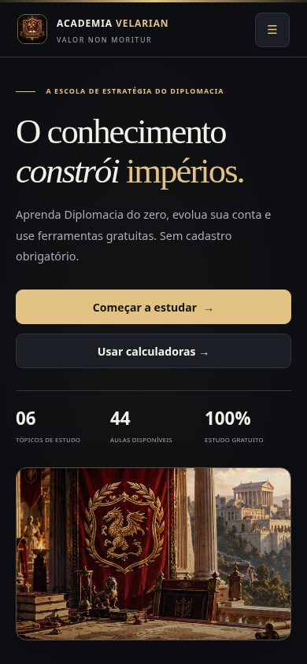 |
| Minha Academia · desktop | 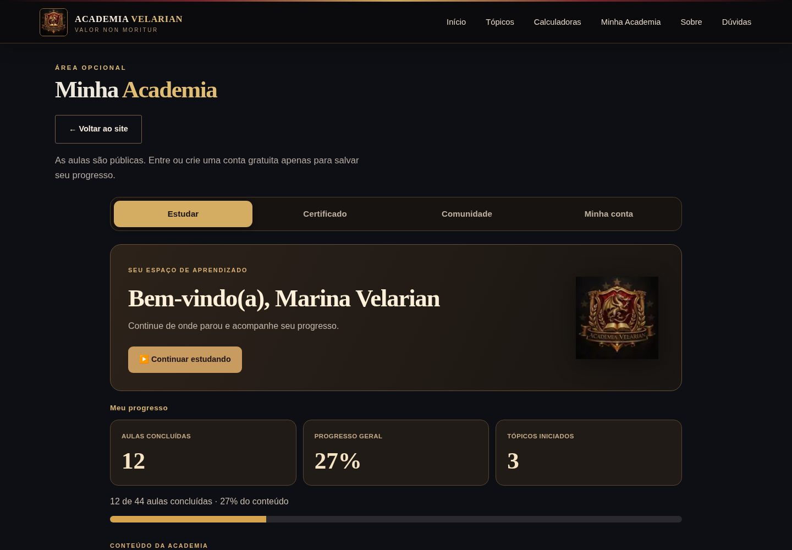 | 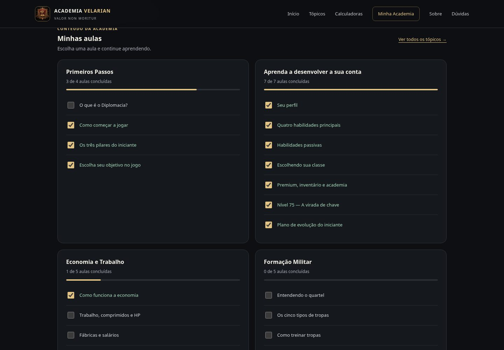 |
| Minha Academia · celular |  |  |
| Calculadoras · desktop | 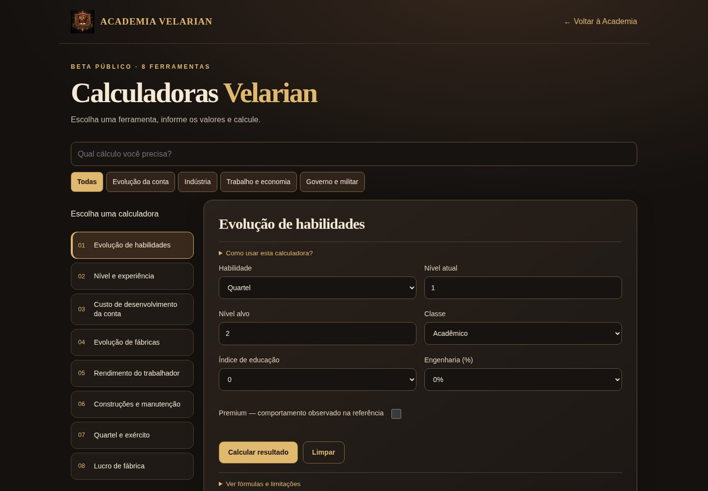 | 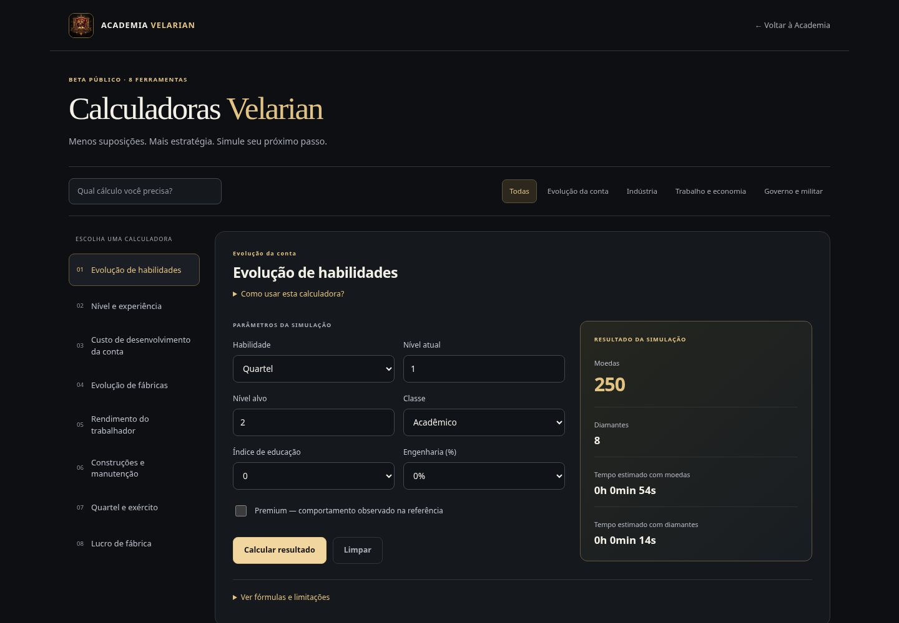 |
| Calculadoras · celular | 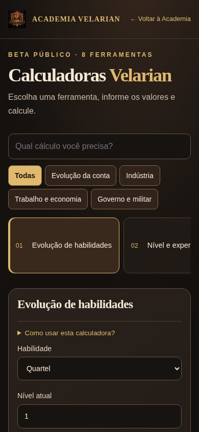 | 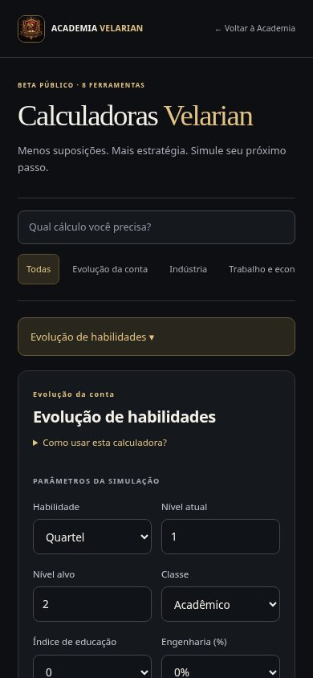 |
| Administração · desktop | 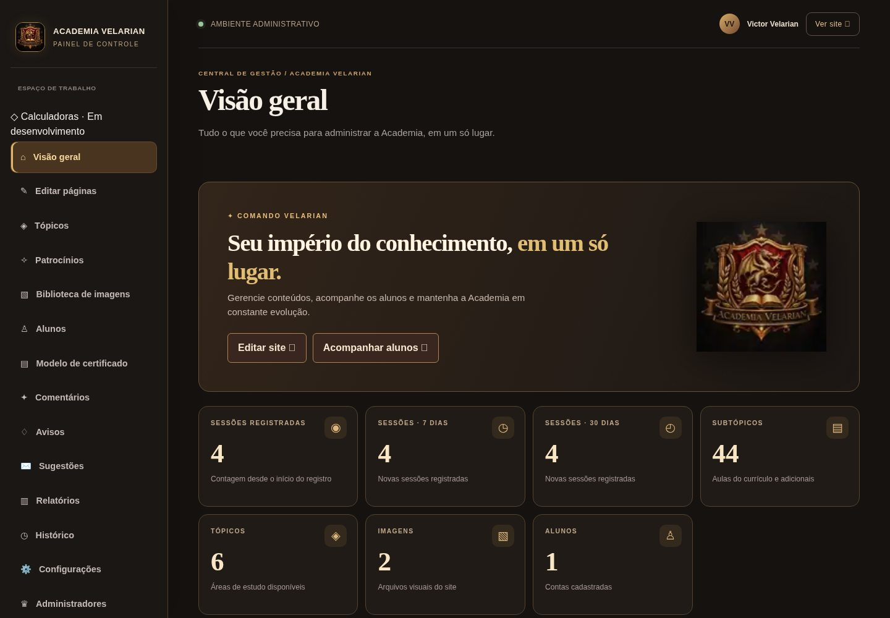 | 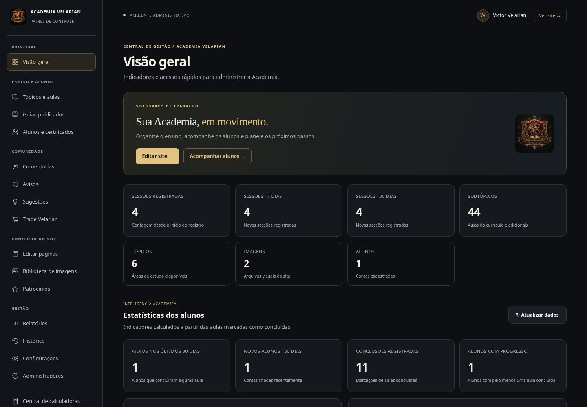 |
| Administração · celular | 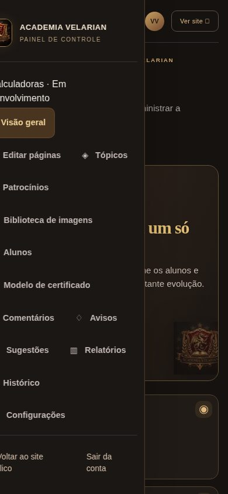 | 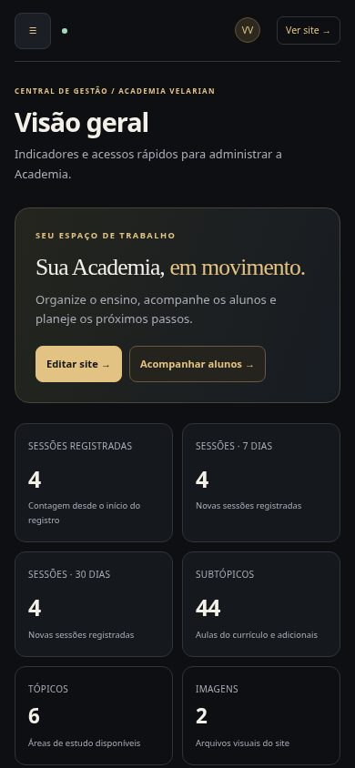 |

### Editor de páginas

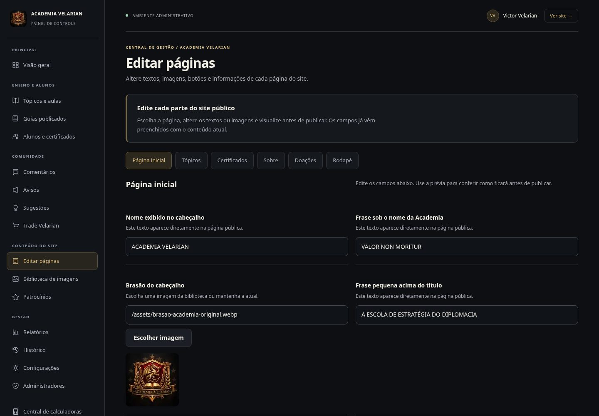

### Relatórios

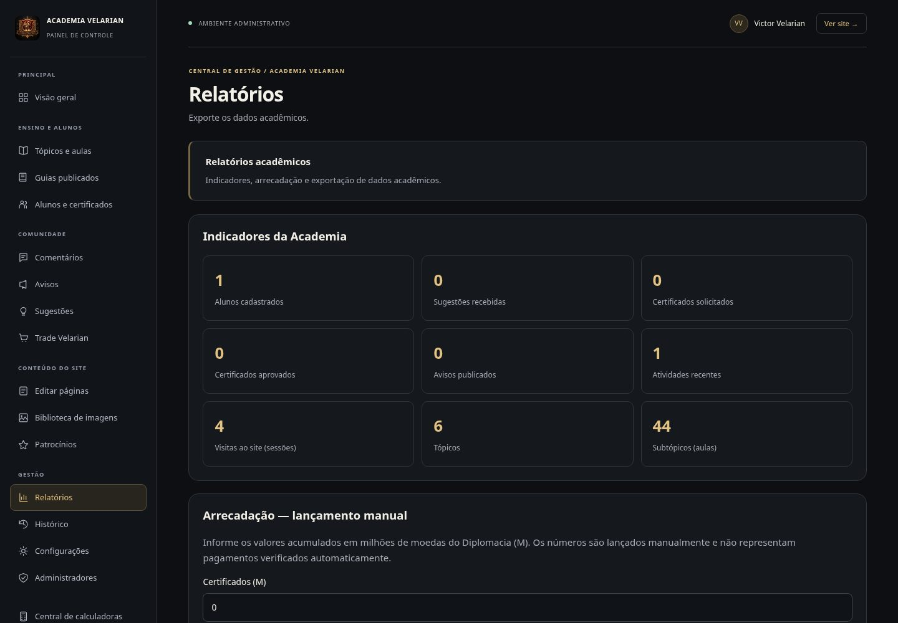

## Limites e pendências

- Todos os testes locais executados passaram. O resultado do CI remoto deve ser conferido no PR após o envio dos commits.
- A verificação automatizada de acessibilidade e de teclado não substitui uma avaliação completa com leitores de tela, pessoas usuárias e dispositivos físicos. Não foram testados Safari e Firefox.
- Os achados P2 de backend da auditoria anterior permanecem fora do escopo visual; não foram alteradas regras de dados, sessões, contagens ou retenção.
- Não houve migração, alteração de credenciais, usuários, permissões ou dados financeiros reais. Nenhum merge ou deploy foi executado.
