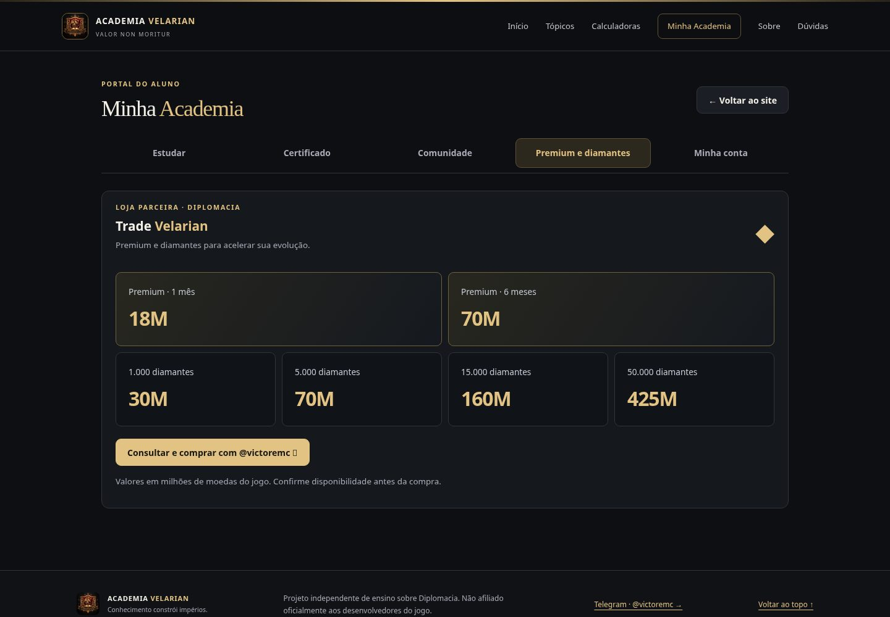
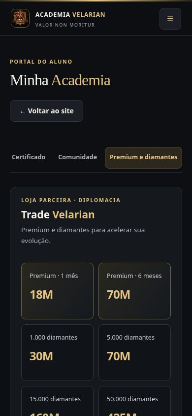

# Refinamento de legibilidade e divulgação

Proposta na branch `design/refinamento-legibilidade-trade`, separada da versão integrada na `main`.

- Preços com maior tamanho e contraste visual.
- Dois cartões Premium destacados na primeira linha e quatro pacotes de diamantes na segunda, no desktop.
- Catálogo adaptado para duas colunas no celular, com todos os produtos disponíveis e sem recolhimento.
- Botão de consulta/compra em dourado e manutenção dos preços, contato e disponibilidade configurados.
- Abas de Minha Academia fixas durante a rolagem e deslizantes horizontalmente em celulares, reduzindo a altura da navegação.
- Ajustes realizados nas regras existentes, sem adicionar outro arquivo de CSS.

Validação: cinco grupos de testes em Chromium passaram, cobrindo 90 estados responsivos/acessíveis com axe-core. Não houve alteração das fórmulas, APIs, banco de dados, permissões ou preços. As imagens utilizam somente dados fictícios do ambiente de testes. Esta proposta não foi publicada em produção.

## Desktop

## Celular

