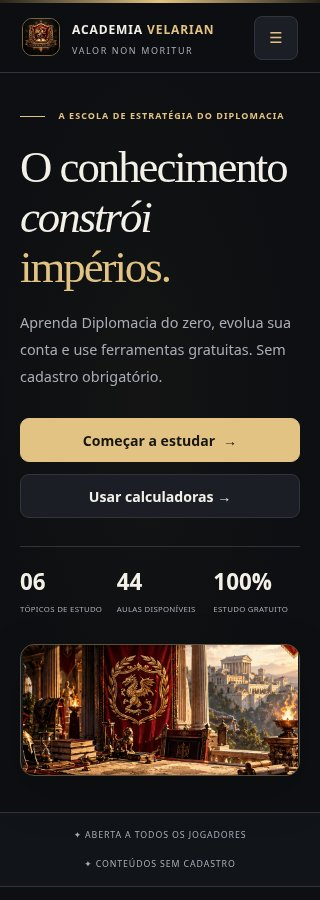
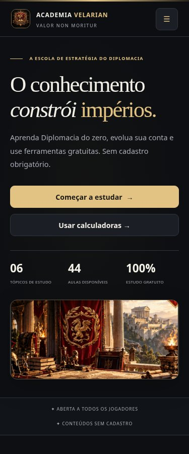
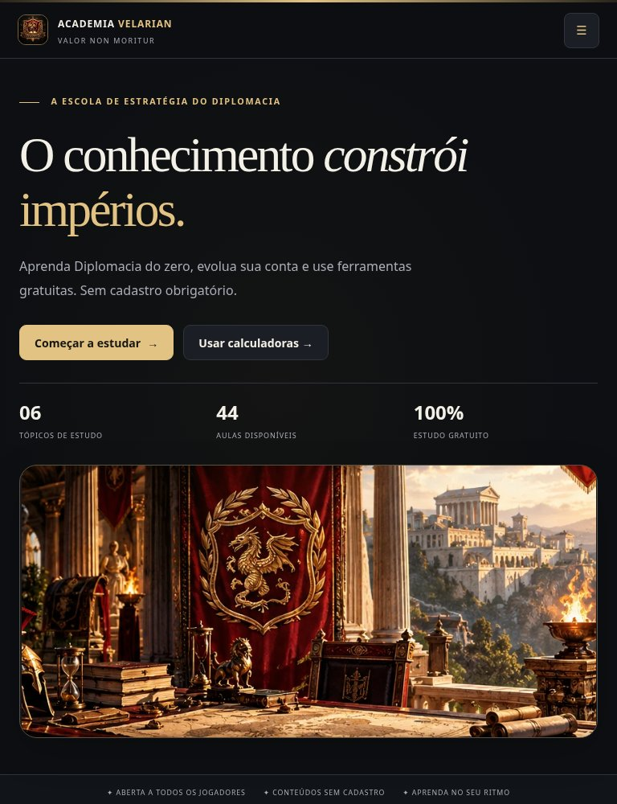
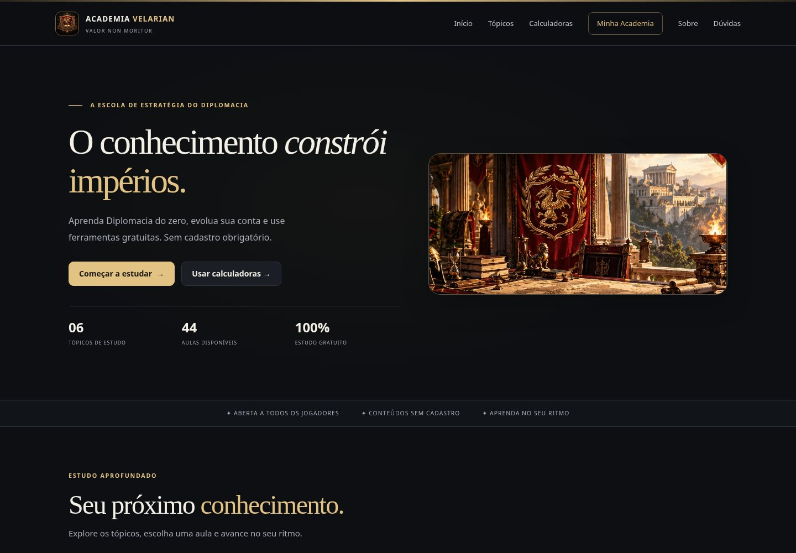

# Correções de vídeos do YouTube e enquadramento das imagens

Branch de revisão: `design/refinamento-legibilidade-trade`. Sem merge ou deploy nesta etapa. O PR #16 já foi integrado anteriormente; estas correções são continuação da reformulação visual.

## Causas identificadas

| Problema | Causa | Correção |
| --- | --- | --- |
| Alguns links eram rejeitados nas aulas, mas aceitos em outros formulários | O backend tinha validadores diferentes para aulas, conteúdo e vídeo geral. A lista de hosts das aulas excluía links móveis e havia truncamento silencioso em 400 caracteres | Um único parser/validador compartilhado entre Worker e navegador; os links novos são validados integralmente, sem corte silencioso |
| Shorts e transmissões ao vivo não apareciam em conteúdos publicados | A extração no frontend de conteúdos publicados reconhecia apenas parte dos formatos aceitos pelo editor de tópicos | A mesma extração de ID é usada em tópicos, aulas e conteúdos publicados |
| O editor indicava erro depois de gravar o tópico | O callback acessava `topicLevel`, uma variável inexistente | Removida a referência inválida; os dados existentes do tópico são carregados antes de habilitar a edição e o nível é preservado |
| Tópicos desapareciam do seletor em um banco sem ordem cadastrada | Uma ordem vazia era transformada em uma lista contendo apenas Roleplay | A ordem vazia utiliza os mesmos tópicos padrão já usados pelo currículo público, sem escrever uma nova ordem no banco |
| Podia haver alteração parcial antes da rejeição do vídeo | O formulário enviava primeiro os dados do tópico e depois o vídeo em outra requisição | O editor valida antes de enviar e salva tópico e vídeo em um único batch transacional. O endpoint antigo de vídeo continua disponível |
| Fechar uma aula aberta por link direto gerava erro JavaScript | O botão administrativo chamado `history` ocultava `window.history` no escopo de `academia-extras.js` | As operações de navegação agora usam `window.history` explicitamente |
| Banner cortado e enquadramento variando conforme a tela | Imagem panorâmica de 846 × 400 apresentada com `cover` em uma caixa esticada de quase 490 px de altura e outros mínimos diferentes nos breakpoints | Moldura responsiva na proporção original, centralizada, com `contain`, sem repetição e sem alturas mínimas conflitantes |
| Outras imagens podiam perder partes do conteúdo | Capas com altura fixa e `cover`; brasão retrato recortado por cantos circulares | Capas em 16:9 com `contain`; brasão com dimensões consistentes, `contain` e cantos suaves |

## Comportamento dos links

O módulo `public/youtube.js` é consumido tanto pelo Worker quanto pelos scripts clássicos do navegador. Não depende de chave de API nem consulta o YouTube para salvar uma aula.

São aceitos `youtube.com/watch?v=`, `youtu.be/`, `/shorts/`, `/live/` e `/embed/`, com parâmetros adicionais, hosts `www`, `m` e `music` apropriados, além de embeds do domínio `youtube-nocookie.com`. Links sem esquema recebem `https://`; links HTTP existentes continuam interpretáveis. IDs devem ter 11 caracteres válidos. Hosts falsos, credenciais no endereço e protocolos executáveis são rejeitados com mensagem explícita.

Os parâmetros dos links são mantidos no valor salvo. Nenhuma linha existente é regravada ou migrada automaticamente. Os players derivam somente o ID validado e utilizam HTTPS no domínio `www.youtube-nocookie.com`, com título, tela cheia, permissões de mídia e `referrerpolicy="strict-origin-when-cross-origin"` consistentes. Endereços antigos longos continuam interpretáveis na leitura; novas gravações têm limite explícito de 8.192 caracteres, sem truncamento automático do campo.

Endpoints verificados:

- `POST /api/admin/lesson` e leitura em `/api/lessons`.
- `POST /api/admin/content` e leitura pública/edição administrativa.
- `POST /api/admin/topic-video` e leitura em `/api/topic-videos`.
- `POST /api/admin/topic`, com vídeo opcional no mesmo batch. Clientes antigos que não enviam o vídeo preservam o valor anterior.

Links inválidos não alteram a aula, o tópico, o conteúdo publicado ou seu histórico. Não foram alteradas permissões nem credenciais.

## Validação

| Teste | Resultado |
| --- | --- |
| `node --test tests/youtube.mjs tests/p1-regressions.mjs` | **20/20** testes aprovados; inclui matriz de formatos, parâmetros, entradas inválidas, autorização negativa, preservação dos dados e rollback |
| `tests/youtube-browser.mjs` em Chromium | **6 grupos aprovados**: cadastro, edição, recarga, links diretos, iframes, imagem personalizada e layout nas quatro larguras |
| `tests/p1-browser.mjs` | **8/8** |
| `tests/design-browser.mjs` com axe-core | **5 grupos aprovados; 90 estados responsivos/acessíveis**, sem erros JavaScript não tratados |
| `tests/audit.mjs` | **28/28** |
| `tests/student-ui.mjs` | **2 verificações aprovadas** |
| `tests/student-hub.mjs` | **5 verificações aprovadas** |
| `tests/admin-permissions-regression.js` | **4 aprovadas** |
| `tests/calculator-regression.js` | **11 aprovados** |
| `tests/calculators.mjs` | **39 aprovados** |
| `tests/calculators-preflight.mjs` | **11 aprovados** |
| `tests/factory-profit.mjs` | **55 aprovados** |
| `tests/homologacao-final.mjs` | **9 aprovados** |
| Matriz `tests/calculators-audit.mjs`, em cópia temporária | **358/358** |
| Wrangler `deploy --dry-run` | Empacotamento aprovado; nenhuma publicação executada |

O teste novo de navegador usa os formulários reais e o Worker com SQLite em memória. Exercita os formatos pedidos no cadastro e na edição, confirma os links após recarregar a página e verifica o endereço, título, permissões e política de referência dos players. Os testes e as capturas não utilizam dados de produção.

Foram verificadas as larguras **320, 375, 768 e 1440 px**, incluindo o editor administrativo, a página inicial e as janelas de vídeo. O banner manteve a proporção de 846:400 e os iframes, 16:9. Não houve transbordamento horizontal. Uma imagem de banner personalizada também foi testada, sem alterar seu valor configurado nem substituir o arquivo.

Os testes existentes que importam o Worker por uma URL `data:` receberam somente a resolução absoluta da nova dependência compartilhada, necessária ao carregamento em Node. O CI inclui os novos testes de vídeos e capturas como artefatos.

## Capturas do banner corrigido

| Largura | Captura |
| --- | --- |
| 320 px |  |
| 375 px |  |
| 768 px |  |
| 1440 px |  |

## Limites e pendências externas

- **A reprodução externa não foi comprovada neste ambiente.** O proxy recusou a conexão a `www.youtube-nocookie.com` com HTTP 403. Os testes de navegador validam a incorporação e bloqueiam chamadas externas; não simulam um sucesso de reprodução. Falta o teste manual de play em um navegador com acesso ao YouTube. Vídeos privados, removidos ou com incorporação desativada dependem das permissões do proprietário.
- A API do GitHub também retorna HTTP 403 neste ambiente, impedindo consultar/editar metadados ou criar um PR pela API. Os commits são disponibilizados pela branch de refinamento para revisão; o PR #16, já integrado, não deve receber outro merge nesta tarefa.
- Nenhuma imagem original, fórmula, schema D1, credencial, atribuição de permissão ou dado de produção foi alterado. Todos os testes locais executados passaram; o resultado do CI remoto ainda precisa ser conferido após o envio.
